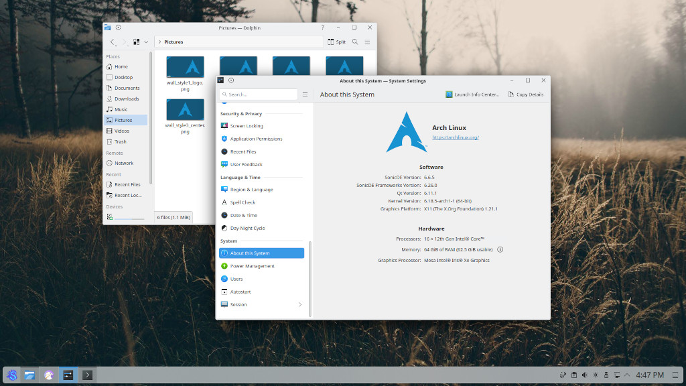

# SonicDE Packages for Arch Linux Systems

This third-party repository provides [SonicDE](https://sonicde.org) x86_64 binary packages for [Arch Linux](https://archlinux.org)-based distributions. SonicDE, or the Sonic Desktop Environment, aims to preserve and improve the X11-specific aspects of KDE. You can learn more about SonicDE at [sonicde.org](https://sonicde.org/).

The packages of this repository are known to work with [Arch Linux](https://archlinux.org), [CachyOS](https://cachyos.org), [EndeavourOS](https://endeavouros.com), [Garuda Linux](https://garudalinux.org), and [RebornOS](https://rebornos.org). We'll also verify the functionality on [ArchCraft](https://archcraft.io) and the testing branch of [Manjaro Linux](https://manjaro.org).

## Switching to SonicDE Automatically

You can download and run the [`sonic-switch.sh`](sonic-switch.sh) script to automatically switch to SonicDE on your Arch-based system:

```
curl -O https://sonicde-arch.github.io/sonic-switch.sh
sh sonic-switch.sh
````

You'll be asked to compare the fingerprint of the OpenPGP key used to sign the packages with this one:
```text
A85B B166 B49A 4C58 C391  2507 3B87 898C 73F1 1DF5
```

The script needs to be run at a [text console](https://wiki.archlinux.org/title/Linux_console) since the installation steps may kill your graphical session. You can switch to the text console via, e.g., `Ctrl+Alt+F3`.

The script will also try to silently replace the conflicting KDE components with the SonicDE ones. If that fails, please answer any interactive `pacman` prompts. At the end, you have the option to switch to the [Sonic Login Manager](https://github.com/Sonic-DE/sonic-login-manager) from your current one. In case you don't get logged out automatically, please do so manually and log in again to start using SonicDE.

The script will also allow you to select one of the repositories mentioned further below. To switch to another one, completely comment your current `[sonicde*]` entry in your `/etc/pacman.conf` and re-run the script.

## Installing SonicDE Manually

### Adding the Public Package Signing Key to pacman

First, please download the public OpenPGP signing key [`sonicde-archlinux.asc`](https://sonicde-arch.github.io/sonicde-archlinux.asc) used to sign the packages and add it to the pacman keyring:

```shell
curl -O https://sonicde-arch.github.io/sonicde-archlinux.asc
sudo pacman-key --add sonicde-archlinux.asc
sudo pacman-key --finger 3B87898C73F11DF5
```

Check that the fingerprint matches before signing the key:

```shell
sudo pacman-key --lsign-key 3B87898C73F11DF5
```

You can read more package signing on the [pacman/Package signing - ArchWiki](https://wiki.archlinux.org/title/Pacman/Package_signing#Adding_unofficial_keys) page.

### Adding a Repository to Pacman

Once you added the public key, also add an entry for the SonicDE repository to the end of the file [`/etc/pacman.conf`](https://man.archlinux.org/man/pacman.conf.5) using [`sudo`](https://wiki.archlinux.org/title/Sudo) and your favorite editor:

#### Stable Repository

This repository contains the latest stable and tested SonicDE version.

```ini
[sonicde]
Server = https://sonicde-arch.github.io/$arch
```

#### Stable-Testing Repository

This repository contains the upcoming stable SonicDE version for testing purposes.

```ini
[sonicde-stable-testing]
Server = https://github.com/sonicde-arch/stable-testing/releases/download/$arch
```

#### Beta Repository

This repository occasionally contains a beta version of SonicDE version for feature development purposes. It's activation and deactivation will be announced in the SonicDE chats.

```ini
[sonicde-beta]
Server = https://github.com/sonicde-arch/beta/releases/download/$arch
```

### Installing SonicDE

Installing SonicDE is as easy as installing the `sonicde-meta` package. Please run the following commands at a [text console](https://wiki.archlinux.org/title/Linux_console)!

```shell
sudo pacman -Syu sonicde-meta
```

If you're using KDE Wayland—which is the default in CachyOS, for example—you'll need to disable the Plasma Login Manager before continuing. Otherwise you may not be able to login to your graphical session anymore. To do so, use the following command:

```shell
sudo systemctl disable plasmalogin
```

The included packages will replace any of their installed KDE counterparts. When asked, just answer with `y`. In case you get kicked out of your graphical session while installing SonicDE on a KDE Wayland system, switch to a [text console](https://wiki.archlinux.org/title/Linux_console) via, e.g., `Ctrl+Alt+F3`, login in as your regular user and enter the following commands:

```shell
sudo pacman -S sonicde-meta
sudo systemctl stop plasmalogin
sudo systemctl enable soniclogin
sudo systemctl start soniclogin
```

It'll enable the Sonic Login Manager and bring you back to a graphical greeter. When logged in again, start the program `System Settings` and verify that you're running SonicDE on the "About this System" page. You do? Congratulations!

P.S. If you prefer SDDM or any other X11 login manager, you may keep using it. This guide just wants to make sure that every user gets back to some sort of graphical greeter.

## Getting in Contact

Please report any enhancement requests or issues with this repository at [Issues · sonicde-arch/sonicde-arch](https://github.com/sonicde-arch/sonicde-arch/issues). If you have a specific issue, please see the [list of package repositories](https://github.com/orgs/sonicde-arch/repositories?q=topic%3Apackage) and report it there. In case you need help, want to report success or talk about other aspects, please also check the official SonicDE channels.

&nbsp;[Bluesky](https://bsky.app/profile/sonicdesktop.bsky.social)&nbsp; &nbsp;[Discord](https://discord.gg/cNZMQ62u5S) &nbsp; &nbsp;[Mastodon](https://mastodon.social/@sonicdesktop) &nbsp; &nbsp;[Matrix](https://matrix.to/#/#sonicdesktop:matrix.org) &nbsp; &nbsp;[OFTC IRC](https://webchat.oftc.net/?channels=sonicde%2Csonicde-devel%2Csonicde-dist&uio=MT11bmRlZmluZWQb1) &nbsp; &nbsp;[Telegram](https://t.me/sonic_de) &nbsp; &nbsp;[X (Twitter)](https://x.com/SonicDesktop)
